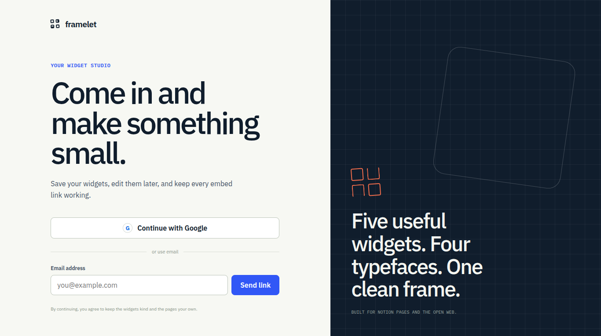
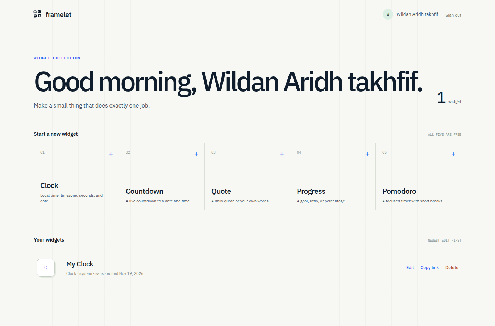
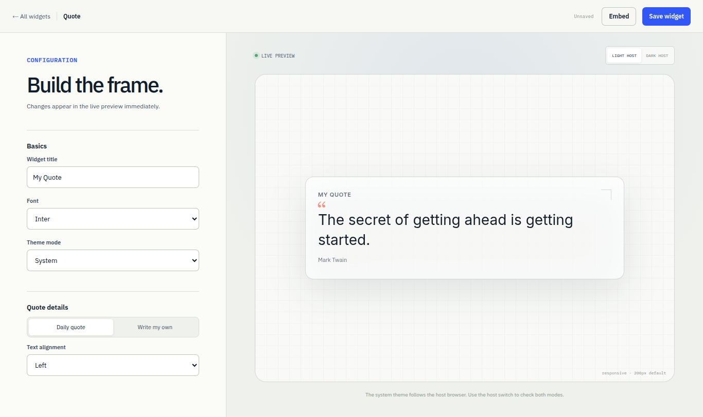

<div align="center">
  <h1>🖼️ Framelet</h1>
  <p><strong>Lightweight, customizable, and embeddable micro-widgets for Notion and the web.</strong></p>

  <p>
    
    
    
    
  </p>

  <p>
    <a href="#-features">Features</a> •
    <a href="#-screenshots">Screenshots</a> •
    <a href="#-tech-stack">Tech Stack</a> •
    <a href="#-getting-started">Getting Started</a>
  </p>
</div>

---

## 📖 Overview

**Framelet** is a web platform that allows users to create, customize, and embed clean, distraction-free widgets directly into Notion pages, personal blogs, or any HTML-supported workspace via a single `<iframe>` URL. 

Built with a focus on fast edge rendering, real-time live preview customization, and seamless light/dark theme adaptation to blend naturally into Notion's UI.

---

## ✨ Features

* **5 Essential Micro-Widgets:**
  1. **Digital & Minimal Clock:** Real-time clock with 12h/24h format toggles and timezone support.
  2. **Event Countdown:** Track deadlines, exams, or launches down to the second.
  3. **Daily Quote:** Curated or custom motivational quotes with clean typography.
  4. **Year / Goal Progress Bar:** Visual percentage bar tracking year, month, week, or custom milestone progress.
  5. **Pomodoro Timer:** Built-in focus & break intervals right inside your workspace.
* **Real-Time Live Editor:** Adjust colors, fonts, borders, and theme modes (Light, Dark, or Auto-match Notion background) with instant preview before copying the embed link.
* **Secure Authentication:** Passwordless Magic Link and Google OAuth powered by Supabase Auth.
* **Lightweight & Responsive Embeds:** Zero-bloat iframe routes optimized for fast loading inside Notion blocks and mobile views.

---

## 📸 Screenshots

### 1. Landing Page & Widget Showcase


### 2. User Dashboard


### 3. Live Widget Customizer


### 4. Embedded Inside Notion
| Light Mode | Dark Mode |
| :---: | :---: |
|  |  |

---

## 🛠️ Tech Stack

* **Framework:** [Next.js](https://nextjs.org/) (App Router)
* **Language:** [TypeScript](https://www.typescriptlang.org/)
* **Backend & Database:** [Supabase](https://supabase.com/) (PostgreSQL, Row Level Security, Google OAuth & Magic Link Auth)
* **Styling:** [Tailwind CSS](https://tailwindcss.com/)
* **Deployment:** Vercel *(sesuaikan jika menggunakan platform lain)*

---

## 🚀 Getting Started

### Prerequisites
* Node.js 18+
* A [Supabase](https://supabase.com/) project

### Installation

1. **Clone the repository**
   ```bash
   git clone [https://github.com/Pinoivceu/Framelet.git](https://github.com/Pinoivceu/Framelet.git)
   cd Framelet